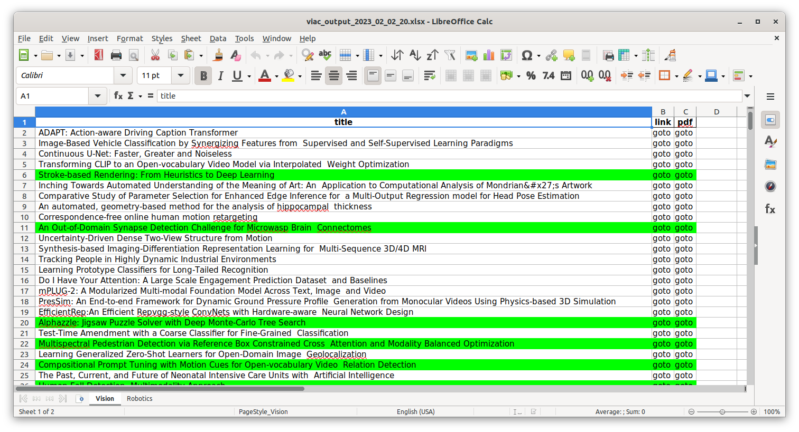

# VI(weekly)AC(academy)

VIAC collects recent arXiv papers for the categories in `config.json`, highlights
titles that match configured keywords, and writes:

- an Excel workbook
- an accessible HTML reading list
- a Markdown prompt containing the matched papers
- optional AI summaries and a Markdown digest



## Requirements

- macOS or another system with Python 3.14
- `$HOME/.venv314`
- `xlsxwriter`
- `pyyaml` (only when using a `.proxy.yaml` file)

Create or update the virtual environment:

```sh
python3.14 -m venv "$HOME/.venv314"
"$HOME/.venv314/bin/python" -m pip install --upgrade pip xlsxwriter pyyaml
```

You can activate it instead of using the full executable path:

```sh
source "$HOME/.venv314/bin/activate"
python viac.py
```

## Configuration

Edit `config.json` in the repository root:

```json
[
  {
    "name": "Vision",
    "id": "cs.CV",
    "keywords": ["lidar", "detect", "autonomous"]
  },
  {
    "name": "Robotics",
    "id": "cs.RO",
    "keywords": ["lidar", "locali", "semantic"]
  }
]
```

- `name`: category label and worksheet name
- `id`: arXiv category code
- `keywords`: case-insensitive title prefixes to highlight

To find a category code, open the [arXiv subject list](https://arxiv.org/list),
select a category, and copy the code from the URL. For example,
`https://arxiv.org/list/cs.CV/recent` uses `cs.CV`.

Keyword matching uses word boundaries and prefixes. `detect` matches
`detector`, `detection`, and `detecting`, but not `undetectable`. Multi-word
keywords match consecutive title words while ignoring punctuation between
words; for example, `point cloud` matches "Point Clouds".

## Run

From the repository root, run the program with the virtual environment:

```sh
"$HOME/.venv314/bin/python" viac.py
```

By default, VIAC creates timestamped files in `reports/`:

```text
reports/
  viac_output_YYYY_MM_DD_HH.xlsx
  viac_output_YYYY_MM_DD_HH.html
  viac_output_YYYY_MM_DD_HH.prompt.md
```

The workbook and companion files share the same base name. `reports/` is ignored
by Git.

### Command-line options

Override the configuration, output path, listing size, or network timeout:

```sh
"$HOME/.venv314/bin/python" viac.py \
  --config config.json \
  --output papers.xlsx \
  --show 100 \
  --timeout 30
```

Valid `--show` values are `25`, `50`, `100`, `250`, `500`, `1000`, and `2000`.
The default is `2000`.

Use `--cache-dir` to cache arXiv category listing pages, or run
`"$HOME/.venv314/bin/python" viac.py --help` for the complete option list.

## Outputs

### Excel workbook

The workbook contains one worksheet per category. Title keyword matches are
highlighted, and each paper includes an arXiv abstract link and PDF link.

### HTML reading list

The HTML report can be opened directly in a browser. It is grouped by category,
labels matches in text as well as color, and includes abstract and PDF links.

### Analysis prompt

The `.prompt.md` companion contains the matched papers grouped by category.
It can be pasted into an AI chat or agent and asks the model to use the linked
sources rather than infer conclusions from titles alone.

### Optional AI summaries

VIAC can send abstracts to any OpenAI-compatible `/chat/completions` endpoint,
including Ollama and hosted providers. Configure the endpoint and model with
command-line options or environment variables:

```sh
export VIAC_LLM_API_KEY="..."
"$HOME/.venv314/bin/python" viac.py \
  --llm-base-url https://api.openai.com/v1 \
  --llm-model <model> \
  --focus "robotics, perception, and autonomous systems"
```

For a local Ollama endpoint:

```sh
"$HOME/.venv314/bin/python" viac.py \
  --llm-base-url http://localhost:11434/v1 \
  --llm-model llama3.1
```

The API key is read only from `VIAC_LLM_API_KEY`; it is never accepted as a
command-line argument. The equivalent environment variables are:

- `VIAC_LLM_BASE_URL`
- `VIAC_LLM_MODEL`
- `VIAC_LLM_API_KEY`

AI runs can also use:

- `--focus TEXT`: tell the model what topics and findings matter
- `--batch-size N`: papers summarized per request (default `5`)
- `--max-papers N`: maximum papers summarized (default `60`)
- `--llm-temperature N`: optional sampling temperature
- `--llm-timeout N`: LLM request timeout in seconds (default `300`)
- `--no-llm`: skip AI summaries even if environment settings are present

When AI summaries succeed, VIAC adds an importance score and summary to the
Excel workbook, adds an AI digest to the HTML report, and writes
`<output-name>.digest.md`. Summary cache data is stored in
`summary_cache.json` beside the workbook and reused across runs.

## Proxy configuration

VIAC uses environment HTTP(S) proxy variables by default. To use a repository-
specific proxy for arXiv requests, copy the example:

```sh
cp .proxy.yaml.example .proxy.yaml
```

Then edit it:

```yaml
http: http://proxy.example:3128
https: http://proxy.example:3128
ftp: http://proxy.example:3128
```

`.proxy.yaml` is ignored by Git.
