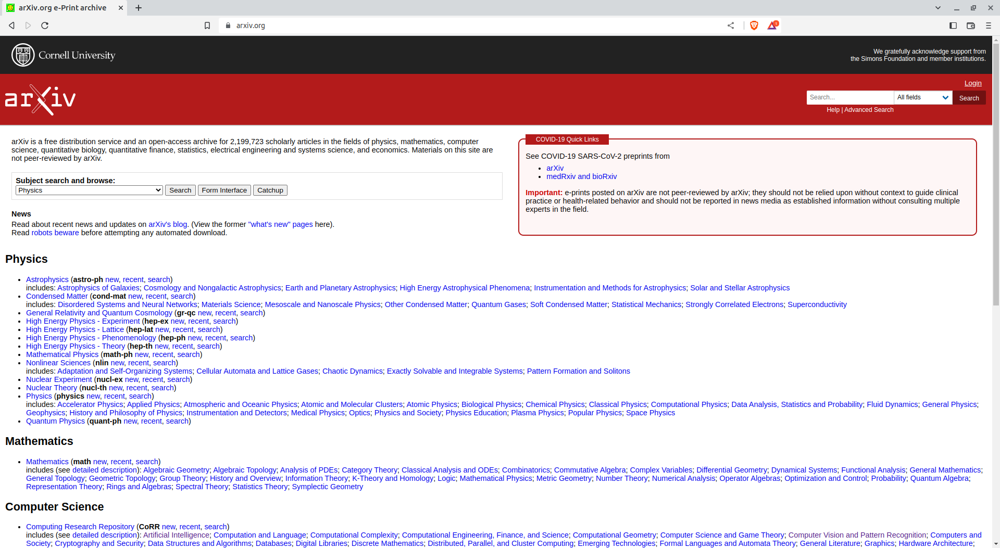
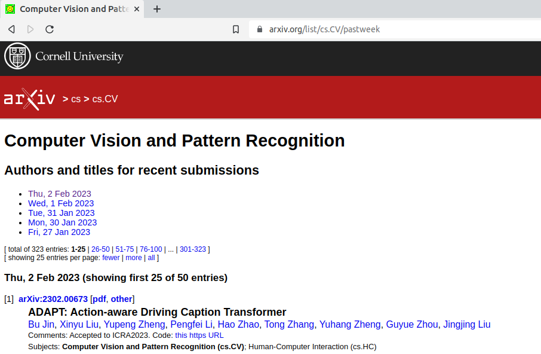

# VI(weekly)AC(academy)

VIAC downloads recently listed arXiv papers for the categories in `config.json` and exports their titles, authors, subjects, abstract links, and PDF links to an Excel workbook.

Titles matching configured keywords are highlighted, making it easier to scan a category once a week.


## Requirements

Python 3.14-compatible virtual environment with:

- `pandas`
- `xlsxwriter`
- `pyyaml`

## Configuration

Edit `config.json`. Each entry creates one worksheet:

```json
[
  {
    "name": "Vision",
    "id": "cs.CV",
    "keywords": ["lidar", "detect", "autonomous"]
  }
]
```

- `name`: worksheet name
- `id`: arXiv category code
- `keywords`: case-insensitive title word prefixes to highlight

For the category code, open the [arXiv list page](https://arxiv.org/list), navigate to a category, and copy the code from the URL. For example, the code for Computer Vision and Pattern Recognition is `cs.CV`.





Keywords are matched at word boundaries, with each keyword token acting as a
prefix. For example, `detect` matches `detector`, `detection`, and `detecting`,
but not `undetectable`. Multi-word keywords match consecutive title words and
ignore punctuation between them.

## Running

Using the project virtual environment:

```sh
$HOME/.venv314/bin/python viac.py
```

By default, the workbook is created in the project directory with a name such as `viac_output_2026_11_22_01.xlsx`.

Override the configuration, output path, number of entries, or network timeout with command-line options:

```sh
$HOME/.venv314/bin/python viac.py --config config.json --output papers.xlsx --show 100 --timeout 30
```

Valid `--show` values are `25`, `50`, `100`, `250`, `500`, `1000`, and `2000`.

Run `--help` for the complete list of options:

```sh
$HOME/.venv314/bin/python viac.py --help
```

## Proxy configuration

Copy `.proxy.yaml.example` to `.proxy.yaml` and add proxy URLs if required:

```yaml
http:
  URL
https:
  URL
ftp:
  URL
```

The `.proxy.yaml` file is excluded from Git.
